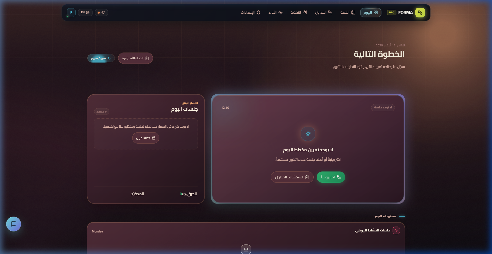
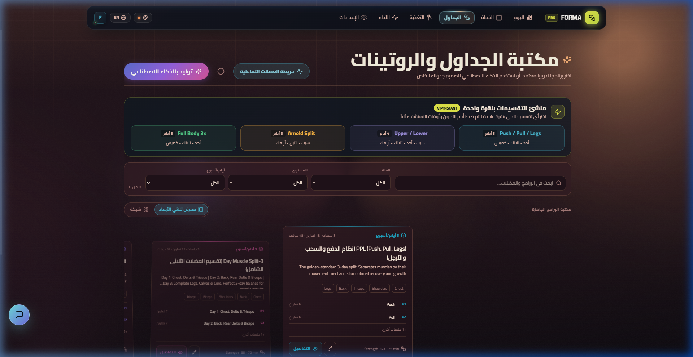
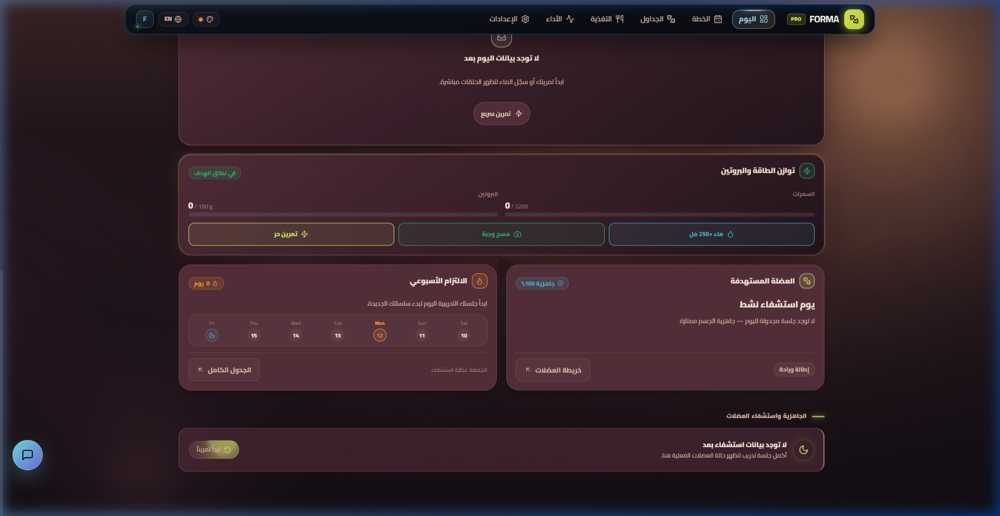
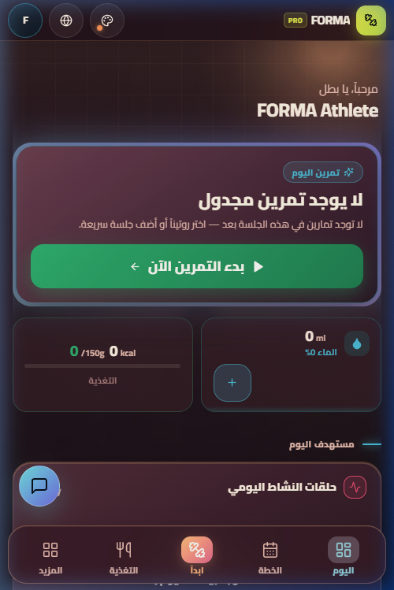

<div align="center">

  

  # FORMA
  ### The Intelligent Athletic Coach & Workout Operating System

  <p align="center">
    <strong>One-thumb fast mid-set telemetry, 3D biomechanics, and precision recovery for athletes — engineered for every screen you own.</strong>
  </p>

  <p align="center">
    <a href="https://mygym-ab892.web.app"></a>
    <a href="https://github.com/AhmadEmad5/MyGym/actions"></a>
    
    
  </p>

  <p align="center">
    
    
    
    
    
    
    
    
  </p>

</div>

---

## 📸 Interface Showcase

<div align="center">
  <h3>⚡ Desktop Flagship Dashboard & Neon Workout HUD</h3>
  <p><em>Equipped with Aceternity <code>BackgroundGradient</code> aura, <code>MovingBorderButton</code> traveling glow, and real-time exercise telemetry.</em></p>
  
</div>

<br />

<table>
  <tr>
    <td width="50%" align="center">
      <h3>🔄 3D Perspective Program Carousel</h3>
      <p><em>Aceternity 3D carousel with cursor parallax tilt & instant grid toggle.</em></p>
      
    </td>
    <td width="50%" align="center">
      <h3>✨ Interactive Glowing Bento Grid (RTL)</h3>
      <p><em>Cursor-following <code>GlowingEffect</code> lasers, fuel meters & recovery readiness.</em></p>
      
    </td>
  </tr>
</table>

<div align="center">
  <h3>📱 Mobile-First Gym Floor Ergonomics (&lt; 768px)</h3>
  <p><em>One-thumb reachability, 60px tactile check-offs, and ambient background gradient aura.</em></p>
  
</div>

---

## 📑 Table of Contents

- [Vision & The Problem](#-vision--the-problem)
- [Design Engineering & Aceternity UI](#-design-engineering--aceternity-ui)
- [Key Features](#-key-features)
- [Architecture & Data Layer](#-architecture--data-layer)
- [Tech Stack](#-tech-stack)
- [Getting Started](#-getting-started)
- [Testing & Quality Gates](#-testing--quality-gates)
- [Security Model & Data Isolation](#-security-model--data-isolation)
- [Deployment & Cross-Platform](#-deployment--cross-platform)
- [License](#-license)

---

## 🎯 Vision & The Problem

Most fitness apps are designed for a comfortable desk. But the most critical moment in training occurs **mid-set, one-handed, while exhausted and sweaty**.

Existing trackers bury set entry behind navigation menus, tiny buttons, and nested modals. **FORMA inverts that paradigm:**
1. **The Workout HUD Comes First** — Logging a set never requires leaving your screen. Primary controls are anchored in the thumb zone.
2. **Glanceable at High Heart Rates** — Volume, rest clocks, and macro budgets are formatted for 1-second legibility.
3. **100% Offline Resilience** — Every write commits immediately to an optimistic local mirror before cloud sync. No spinner mid-workout.
4. **Motion with Intent** — Micro-animations celebrate athletic milestones while honoring reduced motion down to the hardware level.

---

## 💎 Design Engineering & Aceternity UI

FORMA combines cutting-edge motion choreography with dark-mode athletics:

| Aceternity / Motion Component | Implementation & Architectural Role |
| :--- | :--- |
| **`BackgroundGradient`** | Multi-layer animated radial gradient producing an electric neon halo around hero workout surfaces without layout thrashing. |
| **`MovingBorderButton`** | High-energy primary CTAs with SVG path-following radial glow beams for *"Start workout"* and *"Quick workout"*. |
| **`GlowingEffect`** | Interactive cursor-tracking neon laser borders that illuminate Bento Grid cards with semantic tone palettes (Emerald, Lime, Amber, Cyan). |
| **`3D Carousel`** | Program library showcase with interactive mouse parallax coordinates, depth scale falloff, and swipe navigation. |
| **`Meteors`** | Shooting star physics celebrating session completion and 100% daily ring closure. |
| **`useGsapStagger`** | Frame-synchronized hardware-accelerated stagger entrances across cards and feed items. |

> [!NOTE]
> **Accessibility & Reduced Motion:** Every animation strictly listens to both the OS `prefers-reduced-motion` media query and the in-app `data-motion="reduced"` preference, disabling loops and replacing transitions instantly.

---

## 🚀 Key Features

### 🏋️ Training & Gym Floor HUD
- **One-Thumb Workout HUD**: Large set checklist, numeric keypad with kg/lb unit switching, and pause/resume rest timers.
- **Gym Floor Mode**: Oversized ±2.5 kg / ±1 rep thumb steppers, previous-session reference for progressive overload, and 60px check-offs.
- **Multi-Session Split Builder**: Push/Pull/Legs, Upper/Lower, and custom multi-day schedules with full drag-and-drop and keyboard reordering.
- **Glanceable Rest Clock Overlay**: Picture-in-picture floating rest timer with subtle haptic and audio pings.

### 🥗 Nutrition & Energy Balance
- **Smart Macro Dial**: Hero remaining calorie count paired with protein, carbohydrate, and fat budget progress.
- **Meal Scanner & Barcode Lookup**: Instant photo-based macronutrient estimation and barcode scanning.
- **TDEE & Composition Engine**: BMR/TDEE calculation with unit-aware metric/imperial conversions.
- **Wave-Fill Hydration**: One-tap water logging with live progress filling.

### 🧬 Biomechanics & Recovery
- **Muscle Recovery Heatmap**: Muscle-by-muscle readiness calculated from actual training volume and recency.
- **Interactive 3D Muscle Hologram**: Agonist, antagonist, and synergist movement attributions.
- **Athletic Power Radar**: 5-axis visualization mapping strength, volume capacity, consistency, conditioning, and recovery.

### 🌐 Internationalization & Ergo Shell
- **Full Bilingual Support**: Instant runtime toggling between English and Arabic.
- **Zero-Drift RTL Engine**: Built with logical CSS properties (`margin-inline`, `padding-block`, `inset-inline-start`) guaranteeing zero CSS duplication.
- **8 Curated Themes**: Dark, Midnight, Light, Neon, Ocean, Forest, Sunset, and Paper.

---

## 🏛️ Architecture & Data Layer

```
MyGym/
├── src/
│   ├── app/                        # Route definitions & AppShell layout
│   ├── components/
│   │   ├── layout/                 # PageFrame, navigation dock, slide-over sheets
│   │   ├── mobile/                 # GymFloorSetCard, MobileHeroWorkoutCard, steppers
│   │   ├── routines/               # 3D ProgramList, NewSessionDrawer, SplitLibrary
│   │   ├── ui/                     # Aceternity primitives (3d-card, carousel, glowing-effect, etc.)
│   │   └── TodayBentoGrid.tsx      # Flagship Activity Rings & Fuel dashboard
│   ├── hooks/                      # useData (single-source store), useAI, timers
│   ├── lib/                        # api.ts (offline mirror + Firestore), recovery, i18n
│   ├── styles/                     # design-tokens.css, gym-floor.css, today.css
│   └── views/                      # Lazy-loaded top-level views (Today, Routines, Calendar...)
├── functions/                      # Authenticated Cloud Functions & Gemini relay
├── docs/screenshots/               # High-resolution production visual assets
└── firestore.rules                 # User-isolated data security rules
```

---

## 🛠️ Tech Stack

| Domain | Technology |
| :--- | :--- |
| **Framework & Core** | React 18.3, TypeScript 5.5, Vite 5.4 |
| **Styling & Design Tokens** | Tailwind CSS 4, Custom 3-Layer Design Token Engine (Vanilla CSS) |
| **Motion & 3D Components** | Aceternity UI, Framer Motion 14, GSAP 3, Three.js / WebGL |
| **Local Persistence** | `localStorage` mirror + IndexedDB offline cache |
| **Backend & Cloud** | Firebase Cloud Firestore, Authentication, Cloud Functions v2 |
| **Cross-Platform Native** | Capacitor 8 (iOS & Android native containers) |
| **PWA Engine** | `vite-plugin-pwa` with Workbox offline precaching |

---

## 💻 Getting Started

### Prerequisites
- **Node.js**: `20.x` or newer (Tested on Node 20 & 22)
- **npm**: `10.x` or newer

### 1. Clone the repository
```bash
git clone https://github.com/AhmadEmad5/MyGym.git
cd MyGym
```

### 2. Install dependencies
```bash
npm install
```

### 3. Setup environment variables
```bash
cp .env.example .env
```
*(The application runs immediately in **Guest Mode** even without Firebase credentials!)*

### 4. Start development server
```bash
npm run dev
```
Open **http://localhost:1420** in your browser *(port `1420` is pinned in `vite.config.ts`)*.

---

## 🧪 Testing & Quality Gates

The codebase is protected by comprehensive test suites and contracts:

```bash
# Run the Vitest test suite (277 tests)
npm test

# Type-check the entire codebase (0 errors)
npm run typecheck

# Execute production bundle build
npm run build
```

| Test Suite | Coverage |
| :--- | :--- |
| **Design System Contracts** | Verified CSS token consistency and dark-mode compliance |
| **Shell Chrome Contracts** | Safe-area insets, navigation dock visibility, viewport boundaries |
| **Mobile Ergonomics** | Minimum 44px touch targets and thumb-zone reachability |
| **Data Layer & Selectors** | Recovery mathematics, streak calculation, offline sync channels |

---

## 🔒 Security Model & Data Isolation

- **Per-User Isolation**: Cloud Firestore rules strictly enforce `request.auth.uid == userId` for all subcollections (`sessions`, `routines`, `history`, `meals`).
- **No Client Secrets**: Cloud AI requests route through the authenticated `generateGeminiContent` callable with App Check attestation and rate limits.
- **Client Bundle Safety**: No private keys or service accounts exist in client-side code.

---

## 📦 Deployment & Cross-Platform

```bash
# Web & PWA Deployment
npm run build
firebase deploy --only hosting

# Mobile Native Builds (Capacitor)
npm run build:mobile
npx cap open android    # Opens Android Studio
npx cap open ios        # Opens Xcode (macOS)
```

---

## 📄 License

Distributed under the **MIT License**. See [`LICENSE`](./LICENSE) for more information.

<p align="center">
  <strong>Built with precision for athletes worldwide.</strong>
</p>
